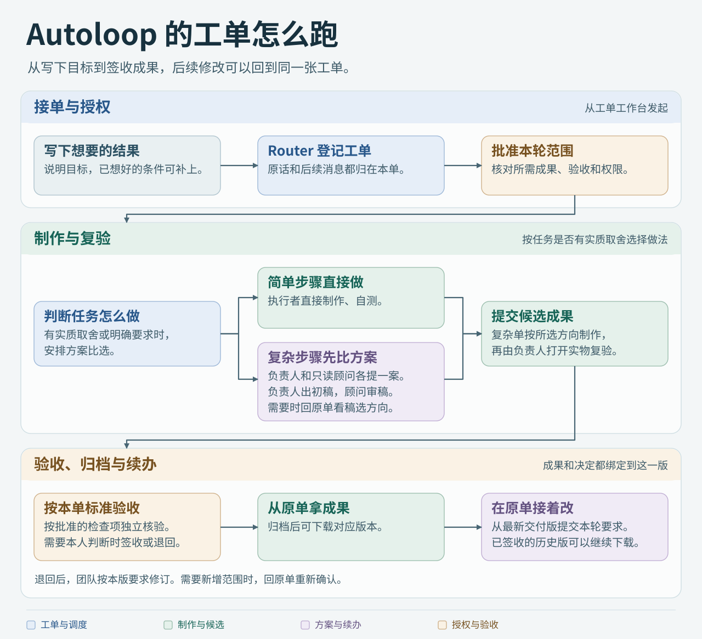
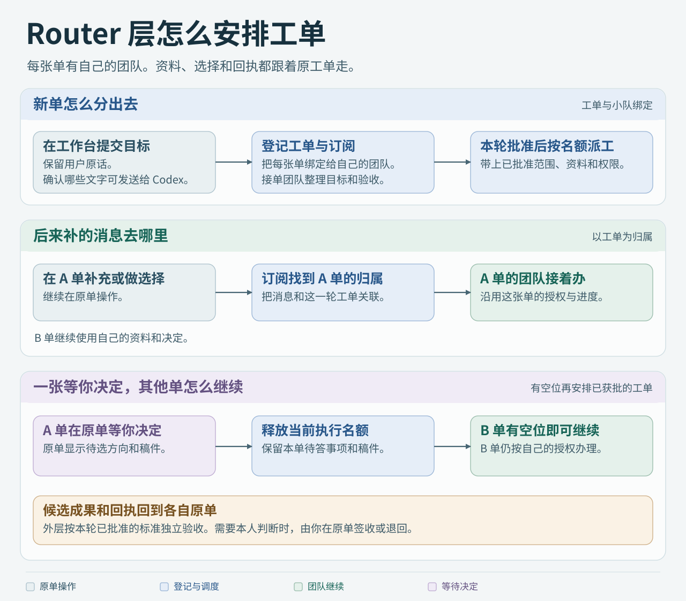
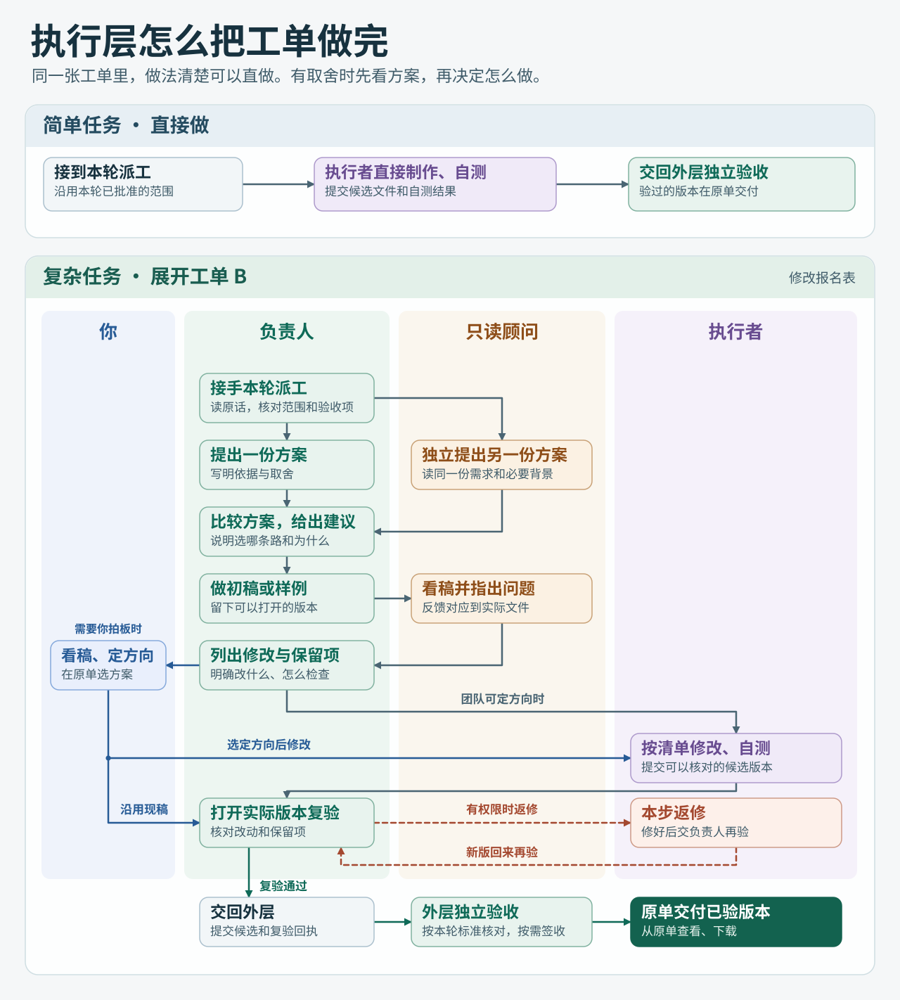
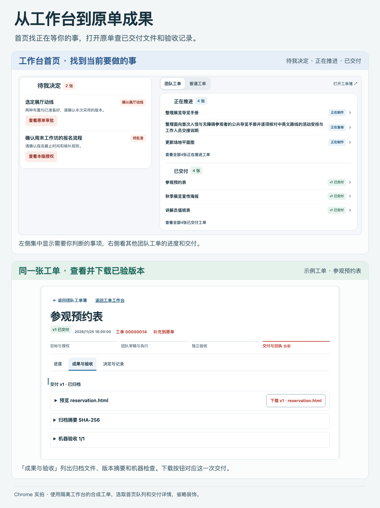

# 目标漫游局 · Autoloop 工作台

Autoloop 是一个在本机运行的任务工作台。你写下想要的结果，Router 会把这张工单交给自己的 Codex 小队。补要求、看方案、做决定和下载成果，都可以回到同一张工单。签收以后也能在原单继续改。

[工单怎么跑](#从目标到交付) · [Router 层](#router-层怎么安排工单) · [执行层](#执行层怎么把工单做完) · [使用效果](#使用效果) · [本机预览](#本机预览)

## 从目标到交付

从「新建工单」写下目标，确认允许发送给 Codex 的文字。团队会先把目标整理成可交付的成果和验收条件，等你批准本轮范围。简单任务走直接制作和自测。遇到实质取舍，负责人和只读顾问各提方案。负责人综合出初稿，顾问审稿。需要你选方向时，可以在原单边看稿边选。

外层按本轮批准的标准独立验收实际候选。需要本人判断时，你在原单签收或退回这一版。下一轮可以从原单最新交付的文件继续，已归档的历史版仍可下载。[工单流程与续办](https://github.com/dinggegu-dot/autoloop-outer-intelligence/blob/be19e116fb4f6abe6e1ad8aeef550c2e75326fe8/docs/product/router-ticket-teams.md)

## Router 层怎么安排工单

Router 登记工单、安排执行名额。工单订阅会把你后来补充的资料、选择和反馈送回负责这张单的小队。一张单等你决定时，会让出名额给其他已批准的工单。

## 执行层怎么把工单做完

Codex 小队接手本轮派工。做法清楚时，执行者直接制作和自测。有实质取舍时，负责人和只读顾问各提方案，比较后出初稿、审稿，必要时请你在原单看稿选方向。简单路线自测后交回候选，复杂路线由负责人复验后再交回。两条路线都由外层独立验收。

负责人、执行者和复核者默认使用 GPT‑6.2 Sol，只读顾问和复杂设计顾问默认使用 GPT‑6.2 Astra。可在「Agent 小队」保存常用分工，也可以在新建时为本单单独选模型和思考强度。[小队配置与实际调用回执](https://github.com/dinggegu-dot/autoloop-outer-intelligence/blob/be19e116fb4f6abe6e1ad8aeef550c2e75326fe8/evidence/goal-team/select-ticket-team.json)

## 使用效果

先在首页的「待我决定」看哪张工单要你处理，也能看到其他工单的进度。打开「参观预约表」原单后，可以预览已交付的文件，查看归档和机器验收，再按版本下载。

下图是 Chrome 中的实际工作台界面，使用隔离环境的合成工单。

真实模型隔离试验中，一张合成读书会工单在签收后连续续办两轮。三版文件都从同一张单下载，并逐份核对了归档摘要。正式本机工作台也用合成签到单验过同单补资料、签收和下载。[连续续办试验](https://github.com/dinggegu-dot/autoloop-outer-intelligence/blob/be19e116fb4f6abe6e1ad8aeef550c2e75326fe8/docs/testing/continuous-ticket-work.md) · [正式工作台合成试单](https://github.com/dinggegu-dot/autoloop-outer-intelligence/blob/be19e116fb4f6abe6e1ad8aeef550c2e75326fe8/evidence/goal-team/router-8765-contact.json)

## 本机预览

可运行的 V2 源码在 `codex/v2-outer-intelligence`。具备仓库访问权和本机 Python 3 后，可以在临时目录打开网页预览。

~~~sh
git clone --branch codex/v2-outer-intelligence https://github.com/dinggegu-dot/autoloop-outer-intelligence.git
cd autoloop-outer-intelligence
preview=$(mktemp -d)
python3 -B 网页工作台/server.py --port 8875 --runtime "$preview/workbench" --hub-home "$preview/hub"
~~~

打开 <http://127.0.0.1:8875/> 浏览预览。完整团队运行按启动手册配置。[试点启动](https://github.com/dinggegu-dot/autoloop-outer-intelligence/blob/be19e116fb4f6abe6e1ad8aeef550c2e75326fe8/docs/operations/pilot.md) · [正式升级与回退](https://github.com/dinggegu-dot/autoloop-outer-intelligence/blob/be19e116fb4f6abe6e1ad8aeef550c2e75326fe8/docs/operations/formal-outer-canary.md) · [设计与运行边界](https://github.com/dinggegu-dot/autoloop-outer-intelligence/blob/be19e116fb4f6abe6e1ad8aeef550c2e75326fe8/docs/architecture/architecture-alignment.md)

配套的 AFR 可以在本机收录和整理研究材料，并用 Obsidian 阅读。[AFR 项目介绍](https://github.com/dinggegu-dot/atom-flow-research-public)
