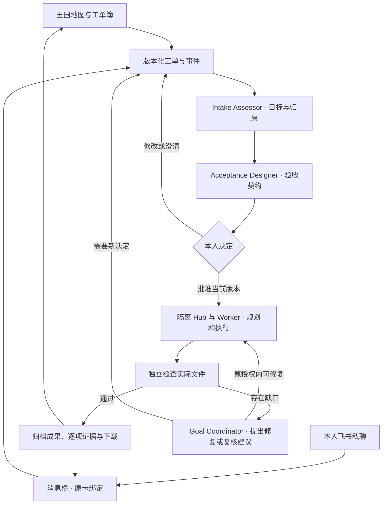

# 目标漫游局 · Autoloop V2

从本人飞书私聊发来一个目标，在王国地图上找到同一张工单，核对范围、验收条件和预算后批准执行。完成卡、逐项验收和下载文件都保留在这张工单里。

[下载候选分支 ZIP](https://github.com/dinggegu-dot/autoloop-outer-intelligence/archive/refs/heads/codex/v2-outer-intelligence.zip) · [运行与回滚](docs/operations/pilot.md) · [实现与实验边界](docs/architecture/architecture-alignment.md)

## 先看地图

在已获仓库访问权的机器上，从候选分支启动。以下命令在本地创建空目录，浏览星球、明信片和王国近景无需模型账号。

```bash
git clone --branch codex/v2-outer-intelligence https://github.com/dinggegu-dot/autoloop-outer-intelligence.git
cd autoloop-outer-intelligence
preview=$(mktemp -d)
python3 -B 网页工作台/server.py --port 8765 --runtime "$preview/workbench" --hub-home "$preview/hub"
```

打开[本机王国地图](http://127.0.0.1:8765/)。拖动旋转，滚轮缩放，左右方向键换站。「近看王国」可看瀑布台地、都市楼群或海岸灯塔。「任务工作台」打开工单簿。独立下载版用本地代码绘制纹理、明信片、角色地标与飞艇，Three.js r180 随库提供。[渲染器许可](网页工作台/vendor/THREE-LICENSE.txt)

本机已有画册时，放在忽略跟踪的 `网页工作台/assets/odyssey` 即可自动沿用。也可在同一启动命令末尾加 `--odyssey-assets "/绝对路径/assets/odyssey"`，沿用原来的角色、飞艇与世界贴图。该目录独立于仓库，服务端只读取指定画册的固定文件名。历史快照、工单数据库及第三方游戏图像保存在个人机器上。

## 一张工单的三个入口

| 在哪里 | 能做什么 | 由什么决定结果 |
| --- | --- | --- |
| 王国地图 | 选择工单，按地标进入目标、决定、预算、执行、验收、成果或角色调用 | 当前工单与对应版本；自由探索可单独查看十个王国 |
| 桌面工单簿 | 发布目标、补充或替换要求、批准本版、查看工作步骤和下载文件 | 工单状态、契约版本、执行与验收记录 |
| 本人飞书私聊 | 发目标，按标题找单，在原卡上回复、指定替换项或批准 | 本人身份、原卡消息、服务端保存的操作与版本 |

## 系统如何协作



三个外层角色由结构化 Codex 调用实现。展开「外层模型调用」可按工单查看实际输入、模型返回、耗时、回执中上报的用量与失败原因。打开 Goal Coordinator 可看到程序采纳的动作，以及同一授权下后续执行和验收的 Run。部分旧记录缺少字段，界面会标明。[源码与运行核对](docs/architecture/architecture-alignment.md) · [真实工单复验](docs/testing/roaming-workbench.md)

## 启用真实执行与飞书

真实试点目前需要 macOS、Python、已安装的 Autoloop 中台及其 Node 运行时，以及可用的 Codex CLI 登录。手册给出独立 Hub、Worker、协调器、网页与飞书桥的启动顺序，也列出环境路径和恢复方式。提交目标可触发真实模型调用。[试点手册](docs/operations/pilot.md)

完整回归会扫描 Git 历史，请使用克隆的工作树。从仓库根目录运行，macOS 可启用真实 Seatbelt 检查。

```bash
GOAL_CHECKS_REAL_SEATBELT=1 python3 -B scripts/check.py
```

| 可复用模块 | 源码与证据 |
| --- | --- |
| 交互地图与微缩地标 | [地图入口](网页工作台/cover.js) · [地标几何](网页工作台/kingdom_relief.js) |
| 桌面工单与模型明细 | [工单详情](网页工作台/outer.js) · [双端共用状态与动作](网页工作台/outer_channels.py) |
| 接单、授权与执行 | [版本化接单](网页工作台/superagent/outer_intake.py) · [协调器](网页工作台/superagent/goal_runtime.py) |
| 本人飞书接续 | [原卡与修改](飞书工作入口/outer_bridge.py) · [温度换算工具真实交付证据](evidence/feishu/verification.json) |

## 工程与验收

- [长期架构依据、实现核对与开放问题](docs/architecture/architecture-alignment.md)和[系统设计共识与架构交接 V1.0 原稿](docs/architecture/design-handoff-v1.0.md)
- [产品任务与完成定义](docs/product/PRD-v2-outer-loop.md)和[架构设计规格](docs/architecture/outer-intelligence.md)
- [源码审计、迁移与恢复边界](docs/architecture/system-overview.md)和[架构取舍](docs/decisions/ADR-INDEX.md)
- [实施计划](docs/plans/v2-implementation-plan.md)、[进度与未决项](docs/progress/v2-status.md)及[需求验收矩阵](docs/testing/acceptance-matrix.md)
- [离线评测与样本范围](docs/testing/evaluation.md)和[候选版 PR](https://github.com/dinggegu-dot/autoloop-outer-intelligence/pull/4)
