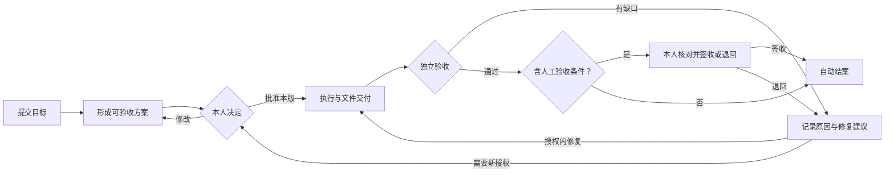
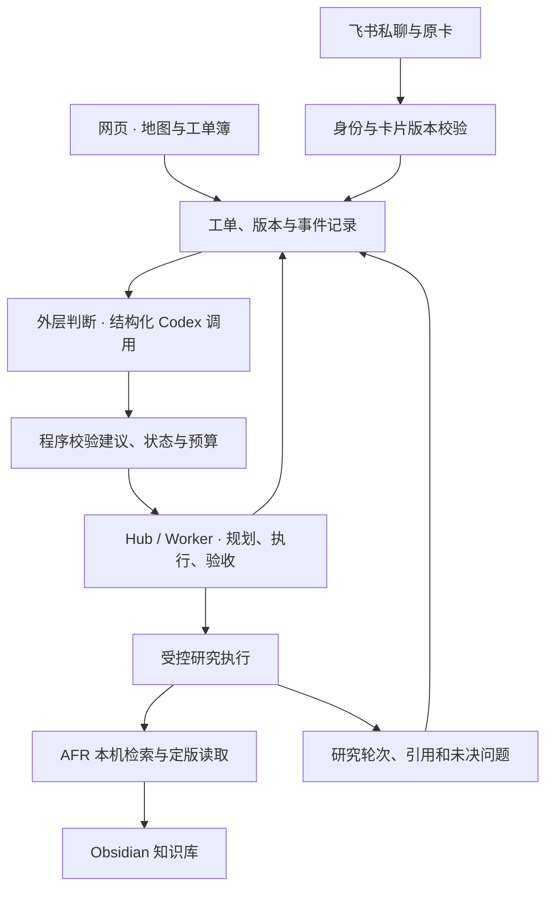

# 目标漫游局 · Autoloop V2

从飞书发来一个目标，在桌面看到同一张工单。Autoloop 把目标整理成可批准的方案，让执行器交付文件，再逐项检查验收条件。研究任务可接入 AFR，在本机知识库查资料，并把每轮读过的版本和引文留在工单里。

[浏览 V2 源码](https://github.com/dinggegu-dot/autoloop-outer-intelligence/tree/867f138e0601ed9bb26d49268c4f33992f94c9b9) · [本机启动与回滚](https://github.com/dinggegu-dot/autoloop-outer-intelligence/blob/867f138e0601ed9bb26d49268c4f33992f94c9b9/docs/operations/pilot.md) · [架构与实验边界](https://github.com/dinggegu-dot/autoloop-outer-intelligence/blob/867f138e0601ed9bb26d49268c4f33992f94c9b9/docs/architecture/architecture-alignment.md) · [配套知识库 AFR](https://github.com/dinggegu-dot/atom-flow-research)

## 从哪里开始

| 想做什么 | 入口 | 可以看到什么 |
| --- | --- | --- |
| 交代或修改任务 | 本人飞书私聊、桌面工单簿 | 目标、方案版本、验收条件、预算与批准记录 |
| 查看进度 | 王国地图 | 每站对应当前工单的一步，点开可看实际记录 |
| 弄清一次模型判断 | 工单的外层模型调用 | 实际输入、返回、耗时、已上报用量及失败原因 |
| 验收交付 | 工单成果与签收 | 候选文件、逐项验收和历史版本；含人工验收条件的工单等待本人签收 |
| 研究一组资料 | 工单下的 AFR 研究执行 | 已读材料、固定版本、引用和未决问题，可沿同一工单追问 |

## 一张工单怎样完成



## 系统结构



**Intake Assessor** 判断目标和归属，**Acceptance Designer** 拟定验收契约，**Goal Coordinator** 在执行或验收遇到缺口时提出下一步建议。三个角色使用不同的提示和结构化输出契约。程序核对建议能否执行，本人的批准绑定具体版本。[角色实现与调用证据](https://github.com/dinggegu-dot/autoloop-outer-intelligence/blob/867f138e0601ed9bb26d49268c4f33992f94c9b9/docs/architecture/architecture-alignment.md)

## 快速开始

`main` 提供项目导览。可运行的 V2 候选代码位于 `codex/v2-outer-intelligence`。以下命令适用于具备仓库访问权的本机 Python 3 环境，会为预览建立独立的临时目录。

```sh
git clone --branch codex/v2-outer-intelligence https://github.com/dinggegu-dot/autoloop-outer-intelligence.git
cd autoloop-outer-intelligence
preview=$(mktemp -d)
python3 -B 网页工作台/server.py --port 8765 --runtime "$preview/workbench" --hub-home "$preview/hub"
```

打开 <http://127.0.0.1:8765/>。如果该端口已运行正式工作台，可将预览端口改为 8875。地图可独立浏览；启用模型执行、Worker 和本人飞书桥需要另外配置。本机私用画册与新版精细近景属于本机部署，候选分支自带可分发的程序地标。[地图实现](https://github.com/dinggegu-dot/autoloop-outer-intelligence/blob/867f138e0601ed9bb26d49268c4f33992f94c9b9/网页工作台/kingdom_relief.js) · [试点配置](https://github.com/dinggegu-dot/autoloop-outer-intelligence/blob/867f138e0601ed9bb26d49268c4f33992f94c9b9/docs/operations/pilot.md)

## 源码与验证

| 关注点 | 从这里读 |
| --- | --- |
| 产品目标与验收范围 | [产品说明](https://github.com/dinggegu-dot/autoloop-outer-intelligence/blob/867f138e0601ed9bb26d49268c4f33992f94c9b9/docs/product/PRD-v2-outer-loop.md) · [验收矩阵](https://github.com/dinggegu-dot/autoloop-outer-intelligence/blob/867f138e0601ed9bb26d49268c4f33992f94c9b9/docs/testing/acceptance-matrix.md) |
| 授权与执行 | [接单与版本](https://github.com/dinggegu-dot/autoloop-outer-intelligence/blob/867f138e0601ed9bb26d49268c4f33992f94c9b9/网页工作台/superagent/outer_intake.py) · [执行协调](https://github.com/dinggegu-dot/autoloop-outer-intelligence/blob/867f138e0601ed9bb26d49268c4f33992f94c9b9/网页工作台/superagent/goal_runtime.py) |
| 双端接续 | [共用状态与动作](https://github.com/dinggegu-dot/autoloop-outer-intelligence/blob/867f138e0601ed9bb26d49268c4f33992f94c9b9/网页工作台/outer_channels.py) · [飞书桥](https://github.com/dinggegu-dot/autoloop-outer-intelligence/blob/867f138e0601ed9bb26d49268c4f33992f94c9b9/飞书工作入口/outer_bridge.py) |
| 研究工具与同单追问 | [研究执行循环](https://github.com/dinggegu-dot/autoloop-outer-intelligence/blob/867f138e0601ed9bb26d49268c4f33992f94c9b9/scripts/afr_research_agent.py) · [AFR 联调记录](https://github.com/dinggegu-dot/autoloop-outer-intelligence/blob/867f138e0601ed9bb26d49268c4f33992f94c9b9/docs/testing/afr-integration.md) |
| 工程维护 | [回归入口](https://github.com/dinggegu-dot/autoloop-outer-intelligence/blob/867f138e0601ed9bb26d49268c4f33992f94c9b9/scripts/check.py) · [当前进度与开放问题](https://github.com/dinggegu-dot/autoloop-outer-intelligence/blob/867f138e0601ed9bb26d49268c4f33992f94c9b9/docs/progress/v2-status.md) · [V2 候选 PR](https://github.com/dinggegu-dot/autoloop-outer-intelligence/pull/4) |

研究联调使用过两轮合成材料。报告与引文已有桌面核对记录，该试点工单的最终系统验收达到时间预算后停止。复验时应分别检查文件是否可读、引文是否可回查、工单是否结案。[完整运行证据](https://github.com/dinggegu-dot/autoloop-outer-intelligence/blob/867f138e0601ed9bb26d49268c4f33992f94c9b9/docs/testing/afr-integration.md)
