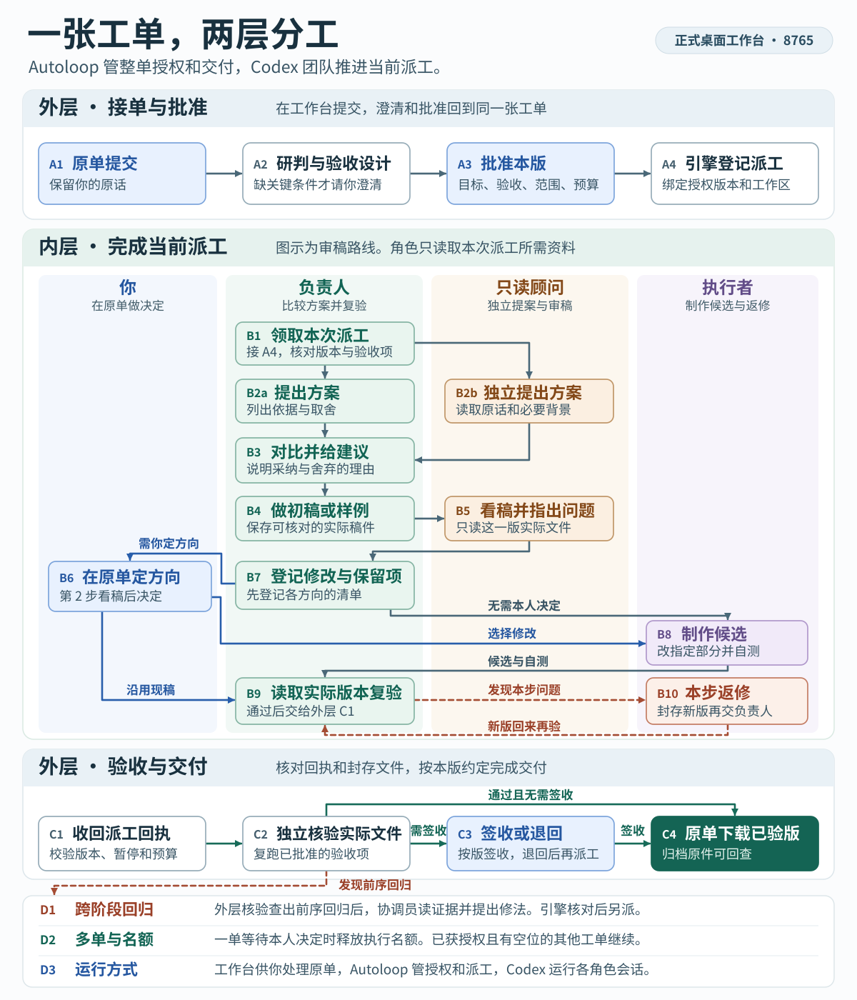

# 一张工单，两层分工

本页对应上一版流程。新建团队工单的分工、订阅和验收见[当前结构图及原单操作](../product/router-ticket-teams.md)。

你希望几件事同时推进，又不想在两个 AI 之间搬运方案和修改意见。Autoloop 用一张原工单保存目标、批准、文件版本和验收结果。外层负责整单的授权、调度、跨阶段返工和交付。内层的 Codex 团队只接手当前派工，把来回讨论变成带版本的方案、修改清单和回执。

这份说明对应 2026-11-25 上线的工作台与 Codex。图中是带审稿的完整路径。短任务和明确选择沿用现稿的单子会按条件走更短的路径。 [发布源码][release]

- [A · 接单与批准](#a-接单与批准)
- [B · 做好当前派工](#b-做好当前派工)
- [C · 核验与交付](#c-核验与交付)
- [D · 跨阶段回归、多单和运行方式](#d-回归多单和运行方式)
- [已经验证到哪里](#已经验证到哪里)

## A 接单与批准

**A1 原单提交。** 在正式首页点「新建工单」，选择「使用 Codex 团队」。页面将名称、原始目标和完成标准一并登记。用户明确勾选同意并点击「登记目标」后，才开始模型研判。浏览器为本次登记保存请求标识，服务端按来源和请求去重，重送会回到原接单事件或工单。原始文字可在原单核对。 [正式表单与分流][entry] · [接单与事件去重][submit]

**A2 研判目标，设计验收。** 接单研判角色先整理用户真正要交付什么、哪些约束是用户说过的，以及缺少哪项关键条件。缺项会在原单产生澄清问题。条件齐全后，验收设计角色把目标拆成可核对的条款。这两次判断使用不同的提示和输出结构。程序用验收器注册表编译这些条款。无法落成可信检查的要求留在「验收缺口」，让用户补充标准。 [接单研判与澄清][intake] · [验收设计与可执行条款][acceptance]

**A3 批准本版。** 原单展示目标版本、验收版本、允许的范围、预算和是否需要本人签收。批准与工单当前修订号一并写入。程序同时核对身份、版本、未处理的新消息和授权条件。同一批准请求可安全重送。授权内的后续派工沿同一方案执行，超范围调整和追加预算需要相应确认。 [版本审批][approve] · [预算增量与续办][budget]

**A4 引擎登记派工。** 引擎先持久化派工，绑定计划步骤、当前授权、派工版本和工作区身份。调度器再向 Hub 投递，确认相应的 Run。Worker 只领取已绑定的派工，重启后可依账本核对原有回执。原单「进度」可以展开派工编号和轮次。 [登记派工][prepare-job] · [Hub 投递与 Run 绑定][dispatch-job] · [Worker 领取与回执][worker]

## B 做好当前派工

**B1 负责人接下当前派工。** Worker 先从最新版检查点装载该步文件和已批准的验收项。角色输入围绕本步，写操作限制在该派工允许的工作区。角色轮次、截止时间和读取记录随派工结算。 [准备执行材料][worker-execute] · [角色执行入口][team-start]

**B2 负责人和只读顾问各提一份方案。** 图中的 B2a 和 B2b 分别表示这两次调用。 完整审稿路径分别新开负责人和顾问会话，两者得到同一份用户原话、必要的上版材料和批准条款。顾问先提出独立做法及可观察的反例。第一轮方案输入中没有负责人的答案。 [独立方案生成][team-plans]

**B3 负责人对照两份方案。** 第三个角色调用拿到两份方案，说明具体采纳和舍弃的理由。同一次派工的两份原方案及比较摘要可从「进度 → 团队审稿」展开。 [比较入口][team-plans] · [原单如何展示两案][show-team]

**B4 做出初稿或样例。** 负责人在工作区做出能实际打开的初稿，再生成文件清单及内容摘要。引擎据此确认这是一份新的、与回执一致的草稿。另有按授权和任务特点选择的样例路径，适用于先看几个方向再制作的任务。 [成稿与封存][seal-draft] · [样例及短任务分流][short-route]

**B5 只读顾问看稿、挑问题。** 顾问读取这版封存文件，在回执中写出相对路径、原文片段和具体问题。程序会检查回执指向的原文和草稿版本。负责人接到的意见可以直接定位到实物。 [顾问实物审稿][seal-draft] · [引用与实际文件校验][handoff-checks]

**B6 在需要时由本人定方向。** 显式选择「分步交付，第 2 步请我定方向」时，先完成前一阶段。第 2 步先准备初稿和只读审稿。负责人登记各方向的修改清单后，原单才发出带具体差异的方向问题。点开待办可阅读当时的封存初稿，比较每个方向要改什么、保留什么。答复验证同一个问题版本及草稿摘要，保存后按原授权续办。该模式至少需要两个可以分别验收的阶段，后续阶段有实质取舍时才会再问。 [选项启用条件与阶段][review-mode] · [封存初稿预览][draft-preview] · [答复入账][preference]

**B7 负责人登记修改和保留项。** 负责人整理顾问意见，把拟改内容、要保留的文句或文件、复验办法写进清单。如果要用户选方向，每个方向先有对应清单，续办时只采用本人选中的一份。程序将清单绑定初稿，按路径和内容核对修改与保留。 [负责人清单和选项][handoff-plan] · [续办回执校验][handoff-settle]

**B8 执行者制作候选成果。** 审稿后需要改动时，执行者从同版封存草稿继续，根据清单和本人意见修改，在可写工作区实际落文件、自测，交回结果。自动路线上的短脚本等简单任务可以由负责人自己制作和检查。 [执行者续办][implement] · [简单路线][short-route]

**B9 负责人打开候选复验。** 审稿续办中，负责人用只读角色打开执行者交回的实际文件，核对修改清单、保留项、批准条款和本人意见。明确选择「沿用现稿」且无补充修改意见时，只需一名只读负责人逐份核对整套封存文件，通过后直接交外层独立核验。原单可以看到当时所见初稿和交回候选的摘要。 [只读核对和续办分流][implement] · [沿用现稿实测][keep-live] · [原单审稿记录][show-team]

**B10 本步返修。** 负责人发现明确问题时登记出错位置、修什么、保留什么。执行者修完后先封存新版，负责人重新打开这份新版复验。时间或可用角色轮次不足时，先保留当前候选和问题。Worker 中断后，程序也从已登记的阶段继续。新版已封存且仍待复验时，只续派只读复验。明确被拒的版本会保留拒绝记录。文件没有实际修改、保留项受损或复验不通过时，无法晋级。 [返修执行][repair-run] · [返修恢复与候选检查][repair-resume] · [真实返修][inner-live] · [封存新版后 Worker 恢复][repair-live]

## C 核验与交付

**C1 收回派工回执。** 引擎按照派工编号和版本检查最新的工单状态、暂停代次、回执来源、授权及用量，再处理结果。已结算的回执不能再次触发业务动作。旧派工的响应在原单留下证据，后面的派工继续依据当前授权。 [结算与过期回执处理][settle] · [暂停后的迟到提案实测][pause-stale]

**C2 独立核验实际文件。** 外层对冻结的候选运行已批准的受信验收器，记录每个验收项、结果和候选摘要。下一阶段和最终交付的核验也会检查此前已验阶段是否被改坏。检查失败会保留候选和证据，按当前步骤或跨阶段问题处理。 [运行外层验收器][outer-review] · [引擎核验和检查点][advance-review]

**C3 需要时由本人签收或退回。** 机器核验通过后，契约有必需的人工验收条款，或者批准时勾选了本人签收，原单就会等待本人核对候选、机器检查和适用的人工条款。选择签收或退回时再验证当前候选和摘要。退回会保存所见版本及意见，让系统按授权接着改。仅含客观检查且授权允许自动交付时，可在归档后直接交付。 [签收与退回][signoff] · [合成简报两版验收][authorized-live]

**C4 从原单下载已验版。** 文件按候选编号、相对路径和归档清单定位，下载前核对存档摘要。HTML 可在原单阅读静态正文，下载保持归档字节。历史退回版本和最终签收版本分开记录。 [归档文件读口][artifact] · [原单成果与预览][show-files] · [正式合成索引下载记录][formal-live]

## D 回归、多单和运行方式

### D1 跨阶段回归

外层检查发现早先通过的步骤在新候选里回归时，进入协调。当前步骤单独失败时，已有受控的本步返修或复验分支。前序阶段受影响或本步重试用完时，再由协调角色判断。目标协调 Agent 在 Codex 中按需调用四项本工单内的只读工具。

| 工具 | 读到什么 |
| --- | --- |
| `read_failure_evidence` | 本轮独立验收的失败证据和相关历史失败 |
| `read_verified_artifacts` | 之前验证过的文件、版本及摘要 |
| `read_plan_versions` | 当前与已记录计划版本，以及受影响的步骤 |
| `read_remaining_budget` | 剩余时限与可安排复验的约束 |

协调器在回执里登记修哪一步、保留哪些文件原字节、如何复验，以及理由。引擎再次检查当前计划、授权、预算、暂停和新反馈。符合条件便在同一次结算里登记决定和后续派工。范围要改时由本人决定。重送同一回执、暂停后返回的旧提案和过期的准备动作各有校验。原单可展开本次工具、协调理由和同一授权下的后续 Run。 [只读工具定义][coord-tools] · [协调运行][coord-run] · [引擎应用提案][apply-coord] · [四工具与错版拒收实测][regression-live] · [原单如何呈现协调回执][show-coord]

### D2 多张工单

当前实现可同时研判两张独立新单。同一张单或来自同一个对话的事件以入队顺序处理。等待本人回复的工单保留状态和封存稿，让出执行名额。其他已有授权且有槽位的单按队列继续。当前正式侧 Worker 同一时间执行一个派工，外层的两个研判名额独立计算。正式工作台的首页汇总「待我决定」，用每张单的最新状态标明原因和动作。某一来源暂时无法读取时，首页分别提示状态，另一侧已确认的待办照常展示。 [接单并发与同源队列][queue-intake] · [正式 Worker 槽位][worker-slots] · [正式首页队列][home-queue] · [等待期间另一单交付实测][slot-live] · [混合待办与掉线验收][ux-live]

### D3 运行方式和其他入口

- **工作台**在原单展示用户动作、步骤、回执和产物。正式版本通过本机签名网关连接侧服务。工单上的操作入口由应用按当前状态呈现，提交时由服务端核对授权。 [正式签名网关][gateway] · [原单状态投影][projection]
- **Autoloop**维护工单、SQLite 记录、授权、派工、调度名额和验收。**Codex**负责模型、会话和工具调用。外层角色调用 Codex CLI。启用团队配置的实施和返修用 Codex App Server，按角色开独立会话。独立机器核验由受信 Worker 执行。此正式审稿链使用 Sol 担任负责人、只读顾问和执行者。Astra 的复杂设计顾问配置与验证单独记录。 [外层 CLI 适配][outer-model] · [内层会话适配][app-server] · [角色配置][team-profile] · [Astra 单独试验][astra-live]
- **飞书与 DSH。** 飞书有已登记的本人卡片和跨端接续，按该路径的验收记录使用。DSH 的同单接入在隔离实验中验证过部分路径。正式团队工单使用工作台入口。正式资料外发依照每单授权。 [飞书跨端记录][feishu-live] · [DSH 隔离记录][dsh-live] · [正式发布与授权边界][ops]

## 已经验证到哪里

| 现场 | 已核对的结果 | 证据 |
| --- | --- | --- |
| 正式 8765，上线后的 Chrome | 统一待办首页可用，已有合成索引原单能打开，机器验收 8/8，两份文件与原验收归档一致 | [本次上线记录][release-note] · [索引终验][formal-live] |
| 隔离正式形态，真实 Codex 合成简报 | 从普通新单登记，批准后在同单看稿、定方向，预算增量后续办，退回 v1 后签收 v2，保留首阶段文件 | [简报完整记录][authorized-live] · [两阶段真实审稿][phase-live] |
| 隔离故障与恢复 | 查出跨阶段回归、四项工具取证、保留已验文件、拒收错版、处理迟到提案，以及新版封存后只续复验 | [跨阶段回归][regression-live] · [旧提案][pause-stale] · [本步恢复][repair-live] |
| 工作台界面回归 | 宽窄屏、键盘、断线恢复、同单定位，独立 GPT 复核。混合状态使用合成数据。原单归档来自之前真实运行 | [449 项回归与回退证据][ux-live] |

多角色路线可以自动传递意见、绑定版本并交给独立核验。团队对结果质量的收益还要按任务比较，已有盲评的八组样例是三胜一平四负。 [匿名对照结果][blind-live]

[release]: https://github.com/dinggegu-dot/autoloop-outer-intelligence/tree/903fb0c19badc8479127be882b4ff8603b53afd4
[release-note]: https://github.com/dinggegu-dot/autoloop-outer-intelligence/pull/15#issuecomment-7160223953
[entry]: https://github.com/dinggegu-dot/autoloop-outer-intelligence/blob/903fb0c19badc8479127be882b4ff8603b53afd4/scripts/prepare_formal_canary.py#L118-L164
[submit]: https://github.com/dinggegu-dot/autoloop-outer-intelligence/blob/903fb0c19badc8479127be882b4ff8603b53afd4/%E7%BD%91%E9%A1%B5%E5%B7%A5%E4%BD%9C%E5%8F%B0/superagent/outer_intake.py#L257-L320
[intake]: https://github.com/dinggegu-dot/autoloop-outer-intelligence/blob/903fb0c19badc8479127be882b4ff8603b53afd4/%E7%BD%91%E9%A1%B5%E5%B7%A5%E4%BD%9C%E5%8F%B0/superagent/outer_intake.py#L901-L979
[acceptance]: https://github.com/dinggegu-dot/autoloop-outer-intelligence/blob/903fb0c19badc8479127be882b4ff8603b53afd4/%E7%BD%91%E9%A1%B5%E5%B7%A5%E4%BD%9C%E5%8F%B0/superagent/outer_intake.py#L981-L1008
[approve]: https://github.com/dinggegu-dot/autoloop-outer-intelligence/blob/903fb0c19badc8479127be882b4ff8603b53afd4/%E7%BD%91%E9%A1%B5%E5%B7%A5%E4%BD%9C%E5%8F%B0/superagent/outer_intake.py#L1030-L1117
[budget]: https://github.com/dinggegu-dot/autoloop-outer-intelligence/blob/903fb0c19badc8479127be882b4ff8603b53afd4/%E7%BD%91%E9%A1%B5%E5%B7%A5%E4%BD%9C%E5%8F%B0/superagent/outer_intake.py#L1188-L1237
[prepare-job]: https://github.com/dinggegu-dot/autoloop-outer-intelligence/blob/903fb0c19badc8479127be882b4ff8603b53afd4/%E7%BD%91%E9%A1%B5%E5%B7%A5%E4%BD%9C%E5%8F%B0/superagent/goal_engine.py#L621-L639
[dispatch-job]: https://github.com/dinggegu-dot/autoloop-outer-intelligence/blob/903fb0c19badc8479127be882b4ff8603b53afd4/%E7%BD%91%E9%A1%B5%E5%B7%A5%E4%BD%9C%E5%8F%B0/superagent/goal_runtime.py#L239-L298
[worker]: https://github.com/dinggegu-dot/autoloop-outer-intelligence/blob/903fb0c19badc8479127be882b4ff8603b53afd4/%E7%BD%91%E9%A1%B5%E5%B7%A5%E4%BD%9C%E5%8F%B0/superagent/goal_runtime.py#L467-L512
[worker-execute]: https://github.com/dinggegu-dot/autoloop-outer-intelligence/blob/903fb0c19badc8479127be882b4ff8603b53afd4/%E7%BD%91%E9%A1%B5%E5%B7%A5%E4%BD%9C%E5%8F%B0/superagent/goal_runtime.py#L516-L550
[team-start]: https://github.com/dinggegu-dot/autoloop-outer-intelligence/blob/903fb0c19badc8479127be882b4ff8603b53afd4/%E7%BD%91%E9%A1%B5%E5%B7%A5%E4%BD%9C%E5%8F%B0/superagent/goal_team_run.py#L146-L195
[team-plans]: https://github.com/dinggegu-dot/autoloop-outer-intelligence/blob/903fb0c19badc8479127be882b4ff8603b53afd4/%E7%BD%91%E9%A1%B5%E5%B7%A5%E4%BD%9C%E5%8F%B0/superagent/goal_team_run.py#L539-L564
[show-team]: https://github.com/dinggegu-dot/autoloop-outer-intelligence/blob/903fb0c19badc8479127be882b4ff8603b53afd4/%E7%BD%91%E9%A1%B5%E5%B7%A5%E4%BD%9C%E5%8F%B0/goal_team.js#L997-L1037
[seal-draft]: https://github.com/dinggegu-dot/autoloop-outer-intelligence/blob/903fb0c19badc8479127be882b4ff8603b53afd4/%E7%BD%91%E9%A1%B5%E5%B7%A5%E4%BD%9C%E5%8F%B0/superagent/goal_team_run.py#L556-L575
[short-route]: https://github.com/dinggegu-dot/autoloop-outer-intelligence/blob/903fb0c19badc8479127be882b4ff8603b53afd4/%E7%BD%91%E9%A1%B5%E5%B7%A5%E4%BD%9C%E5%8F%B0/superagent/goal_team_run.py#L617-L684
[handoff-checks]: https://github.com/dinggegu-dot/autoloop-outer-intelligence/blob/903fb0c19badc8479127be882b4ff8603b53afd4/%E7%BD%91%E9%A1%B5%E5%B7%A5%E4%BD%9C%E5%8F%B0/superagent/goal_team_handoff.py
[review-mode]: https://github.com/dinggegu-dot/autoloop-outer-intelligence/blob/903fb0c19badc8479127be882b4ff8603b53afd4/%E7%BD%91%E9%A1%B5%E5%B7%A5%E4%BD%9C%E5%8F%B0/superagent/goal_engine.py#L1164-L1175
[draft-preview]: https://github.com/dinggegu-dot/autoloop-outer-intelligence/blob/903fb0c19badc8479127be882b4ff8603b53afd4/%E7%BD%91%E9%A1%B5%E5%B7%A5%E4%BD%9C%E5%8F%B0/superagent/outer_intake.py#L419-L495
[preference]: https://github.com/dinggegu-dot/autoloop-outer-intelligence/blob/903fb0c19badc8479127be882b4ff8603b53afd4/%E7%BD%91%E9%A1%B5%E5%B7%A5%E4%BD%9C%E5%8F%B0/superagent/outer_intake.py#L1120-L1187
[handoff-plan]: https://github.com/dinggegu-dot/autoloop-outer-intelligence/blob/903fb0c19badc8479127be882b4ff8603b53afd4/%E7%BD%91%E9%A1%B5%E5%B7%A5%E4%BD%9C%E5%8F%B0/superagent/goal_team_run.py#L576-L613
[handoff-settle]: https://github.com/dinggegu-dot/autoloop-outer-intelligence/blob/903fb0c19badc8479127be882b4ff8603b53afd4/%E7%BD%91%E9%A1%B5%E5%B7%A5%E4%BD%9C%E5%8F%B0/superagent/goal_engine.py#L1286-L1379
[implement]: https://github.com/dinggegu-dot/autoloop-outer-intelligence/blob/903fb0c19badc8479127be882b4ff8603b53afd4/%E7%BD%91%E9%A1%B5%E5%B7%A5%E4%BD%9C%E5%8F%B0/superagent/goal_team_run.py#L485-L538
[repair-run]: https://github.com/dinggegu-dot/autoloop-outer-intelligence/blob/903fb0c19badc8479127be882b4ff8603b53afd4/%E7%BD%91%E9%A1%B5%E5%B7%A5%E4%BD%9C%E5%8F%B0/superagent/goal_team_run.py#L298-L412
[repair-resume]: https://github.com/dinggegu-dot/autoloop-outer-intelligence/blob/903fb0c19badc8479127be882b4ff8603b53afd4/%E7%BD%91%E9%A1%B5%E5%B7%A5%E4%BD%9C%E5%8F%B0/superagent/goal_engine.py#L487-L561
[settle]: https://github.com/dinggegu-dot/autoloop-outer-intelligence/blob/903fb0c19badc8479127be882b4ff8603b53afd4/%E7%BD%91%E9%A1%B5%E5%B7%A5%E4%BD%9C%E5%8F%B0/superagent/goal_engine.py#L742-L782
[outer-review]: https://github.com/dinggegu-dot/autoloop-outer-intelligence/blob/903fb0c19badc8479127be882b4ff8603b53afd4/%E7%BD%91%E9%A1%B5%E5%B7%A5%E4%BD%9C%E5%8F%B0/superagent/goal_runtime.py#L732-L763
[advance-review]: https://github.com/dinggegu-dot/autoloop-outer-intelligence/blob/903fb0c19badc8479127be882b4ff8603b53afd4/%E7%BD%91%E9%A1%B5%E5%B7%A5%E4%BD%9C%E5%8F%B0/superagent/goal_engine.py#L1465-L1535
[signoff]: https://github.com/dinggegu-dot/autoloop-outer-intelligence/blob/903fb0c19badc8479127be882b4ff8603b53afd4/%E7%BD%91%E9%A1%B5%E5%B7%A5%E4%BD%9C%E5%8F%B0/superagent/outer_intake.py#L1239-L1304
[artifact]: https://github.com/dinggegu-dot/autoloop-outer-intelligence/blob/903fb0c19badc8479127be882b4ff8603b53afd4/%E7%BD%91%E9%A1%B5%E5%B7%A5%E4%BD%9C%E5%8F%B0/workbench.py#L795-L876
[show-files]: https://github.com/dinggegu-dot/autoloop-outer-intelligence/blob/903fb0c19badc8479127be882b4ff8603b53afd4/%E7%BD%91%E9%A1%B5%E5%B7%A5%E4%BD%9C%E5%8F%B0/goal_team.js#L1254-L1296
[coord-tools]: https://github.com/dinggegu-dot/autoloop-outer-intelligence/blob/903fb0c19badc8479127be882b4ff8603b53afd4/%E7%BD%91%E9%A1%B5%E5%B7%A5%E4%BD%9C%E5%8F%B0/superagent/coordination_tools.py#L12-L109
[coord-run]: https://github.com/dinggegu-dot/autoloop-outer-intelligence/blob/903fb0c19badc8479127be882b4ff8603b53afd4/%E7%BD%91%E9%A1%B5%E5%B7%A5%E4%BD%9C%E5%8F%B0/superagent/goal_runtime.py#L766-L803
[apply-coord]: https://github.com/dinggegu-dot/autoloop-outer-intelligence/blob/903fb0c19badc8479127be882b4ff8603b53afd4/%E7%BD%91%E9%A1%B5%E5%B7%A5%E4%BD%9C%E5%8F%B0/superagent/goal_engine.py#L1882-L1947
[show-coord]: https://github.com/dinggegu-dot/autoloop-outer-intelligence/blob/903fb0c19badc8479127be882b4ff8603b53afd4/%E7%BD%91%E9%A1%B5%E5%B7%A5%E4%BD%9C%E5%8F%B0/outer.js#L3-L125
[queue-intake]: https://github.com/dinggegu-dot/autoloop-outer-intelligence/blob/903fb0c19badc8479127be882b4ff8603b53afd4/%E7%BD%91%E9%A1%B5%E5%B7%A5%E4%BD%9C%E5%8F%B0/superagent/outer_intake.py#L704-L740
[worker-slots]: https://github.com/dinggegu-dot/autoloop-outer-intelligence/blob/903fb0c19badc8479127be882b4ff8603b53afd4/scripts/formal_outer_canary_supervisor.py#L162-L178
[home-queue]: https://github.com/dinggegu-dot/autoloop-outer-intelligence/blob/903fb0c19badc8479127be882b4ff8603b53afd4/scripts/formal_home_goal_queue.js
[gateway]: https://github.com/dinggegu-dot/autoloop-outer-intelligence/blob/903fb0c19badc8479127be882b4ff8603b53afd4/scripts/formal_outer_canary.py#L198-L275
[projection]: https://github.com/dinggegu-dot/autoloop-outer-intelligence/blob/903fb0c19badc8479127be882b4ff8603b53afd4/%E7%BD%91%E9%A1%B5%E5%B7%A5%E4%BD%9C%E5%8F%B0/outer_channels.py#L110-L199
[outer-model]: https://github.com/dinggegu-dot/autoloop-outer-intelligence/blob/903fb0c19badc8479127be882b4ff8603b53afd4/%E7%BD%91%E9%A1%B5%E5%B7%A5%E4%BD%9C%E5%8F%B0/superagent/outer_model.py#L226-L264
[app-server]: https://github.com/dinggegu-dot/autoloop-outer-intelligence/blob/903fb0c19badc8479127be882b4ff8603b53afd4/%E7%BD%91%E9%A1%B5%E5%B7%A5%E4%BD%9C%E5%8F%B0/superagent/goal_app_server.py#L677-L703
[team-profile]: https://github.com/dinggegu-dot/autoloop-outer-intelligence/blob/903fb0c19badc8479127be882b4ff8603b53afd4/%E7%BD%91%E9%A1%B5%E5%B7%A5%E4%BD%9C%E5%8F%B0/superagent/goal_team_records.py#L13-L20
[ops]: https://github.com/dinggegu-dot/autoloop-outer-intelligence/blob/903fb0c19badc8479127be882b4ff8603b53afd4/docs/operations/formal-outer-canary.md
[formal-live]: https://github.com/dinggegu-dot/autoloop-outer-intelligence/blob/903fb0c19badc8479127be882b4ff8603b53afd4/evidence/goal-coordinator/formal-8765.json
[feishu-live]: https://github.com/dinggegu-dot/autoloop-outer-intelligence/blob/903fb0c19badc8479127be882b4ff8603b53afd4/evidence/feishu/verification.json
[authorized-live]: https://github.com/dinggegu-dot/autoloop-outer-intelligence/blob/903fb0c19badc8479127be882b4ff8603b53afd4/evidence/goal-team/authorized-workbench-live.json
[phase-live]: https://github.com/dinggegu-dot/autoloop-outer-intelligence/blob/903fb0c19badc8479127be882b4ff8603b53afd4/evidence/goal-team/phase-two-collaboration-live.json
[inner-live]: https://github.com/dinggegu-dot/autoloop-outer-intelligence/blob/903fb0c19badc8479127be882b4ff8603b53afd4/evidence/goal-team/inner-repair-live.json
[repair-live]: https://github.com/dinggegu-dot/autoloop-outer-intelligence/blob/903fb0c19badc8479127be882b4ff8603b53afd4/evidence/goal-team/written-repair-recovery-live.json
[pause-stale]: https://github.com/dinggegu-dot/autoloop-outer-intelligence/blob/903fb0c19badc8479127be882b4ff8603b53afd4/evidence/goal-team/pause-stale-real-api.json
[regression-live]: https://github.com/dinggegu-dot/autoloop-outer-intelligence/blob/903fb0c19badc8479127be882b4ff8603b53afd4/evidence/goal-team/regression-real-api.json
[slot-live]: https://github.com/dinggegu-dot/autoloop-outer-intelligence/blob/903fb0c19badc8479127be882b4ff8603b53afd4/evidence/goal-team/waiting-slot-real-api.json
[ux-live]: https://github.com/dinggegu-dot/autoloop-outer-intelligence/blob/903fb0c19badc8479127be882b4ff8603b53afd4/evidence/goal-team/workbench-flow-ui.json
[astra-live]: https://github.com/dinggegu-dot/autoloop-outer-intelligence/blob/903fb0c19badc8479127be882b4ff8603b53afd4/evidence/goal-team/astra-design-probe.json
[dsh-live]: https://github.com/dinggegu-dot/autoloop-outer-intelligence/blob/903fb0c19badc8479127be882b4ff8603b53afd4/evidence/goal-team/dsh-runtime.json
[blind-live]: https://github.com/dinggegu-dot/autoloop-outer-intelligence/blob/903fb0c19badc8479127be882b4ff8603b53afd4/evidence/goal-team/blind-owner-result.json
[keep-live]: https://github.com/dinggegu-dot/autoloop-outer-intelligence/blob/903fb0c19badc8479127be882b4ff8603b53afd4/evidence/goal-team/draft-preview-live.json
