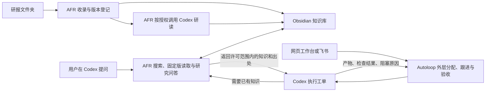

# AFR 与 Autoloop 产品方案和首版 PRD

2026-11-22 · 首批支持平台建议为 macOS · [下一步执行、验收与回退计划](next-delivery-plan.md)

把一份研报放进指定文件夹，用户希望下次打开 Obsidian 就能看到整理好的论述，并能问 Codex「作者为什么这样判断」。这是 **AFR**。在飞书或网页交给系统一个目标，用户希望离开后它仍会推进、核验和交付，需要知识时自己查 AFR。这是 **Autoloop**。用户可以只装其中一个，也可以把两者连起来。

**建议首版交付两款本机软件，分别维护在现有两个 GitHub 仓库。** AFR 以 Obsidian 为阅读界面、Codex 为对话入口，带本机收录程序。Autoloop 以已有星球风格的本地网页为工作台，带能独立于浏览器继续运行的执行服务，飞书是可选入口。GitHub 提供源码和版本下载。建议下载包各带一个本机启动脚本。未登录时可浏览预置的合成白板或工单，并体验本机收录及搜索。现场让 Agent 阅读、回答或执行任务，需先连接用户自己的 Codex。首次配置由引导检查目录、依赖和登录状态。

## 一、为什么选这种形态

| 选择 | 对使用者和维护者的影响 | 首版决定 |
| --- | --- | --- |
| 本机服务配现有界面 | 用户直接在 Obsidian 阅读，在浏览器跟进任务。可复用已有白板、网页、执行器和本机文件权限 | 采用。提供引导、启动、状态、停止和诊断入口 |
| Obsidian 社区插件 | 可以把状态、重新整理等动作放进侧栏，但持续收录还要覆盖 Obsidian 关闭时段 | 后续按使用反馈增加轻量入口，收录和接口由 AFR 维护 |
| 原生桌面 App 或托管网站 | 桌面安装器可减少环境配置。托管网站还要解决用户资料上传、账号、存储和服务费用 | 新机器实测若反复卡在启动或依赖，先增加 macOS 启动器或安装包。共享在线服务另行立项 |

用户能否下载，取决于发布版本和仓库读取权限。点开即用的原生 App 只是可能的发行附件之一。GitHub Release 可在固定标签下附上下载包、校验文件和版本说明。私有测试邀请有权限的用户，需要面向公众分发时由所有者决定公开范围和许可。[GitHub Releases](https://docs.github.com/en/repositories/releasing-projects-on-github/about-releases) · [仓库许可](https://docs.github.com/en/repositories/managing-your-repositorys-settings-and-features/customizing-your-repository/licensing-a-repository)

图中的连接表示产品能力。每次让托管 Codex 阅读文本时，资料授权同时约束输入提示和工具返回值。独立使用 AFR 时由 AFR 接收问题，联用时由 Autoloop 保存工单和交付历史。

## 二、从现在出发

| 能力 | 已有依据 | 首版尚需交付或验证 |
| --- | --- | --- |
| AFR 本机收录与知识库 | GitHub main 的 `afr_agent` 提供 scan、search、read、evidence、publish。已有原件去重、固定证据、初读 Canvas、完整阅读发布和人工编辑保护。已在 GitHub 版源码和已有 Python 3.11 环境上通过 15 项合成回归 | 独立验证全新环境的依赖安装。独立启动自动收录，从新用户的目录跑到 Obsidian |
| 完整话题与自动归类 | 曾用离线模型在本机试点。五份正式材料中四份已发布，第五份停止，原工单的五篇综合及追问停在提交前。用户已撤下离线模型 | 沿用覆盖、回源和人工编辑保护的验收标准。以现有 Codex harness 和允许的材料重新验收语义质量。正式材料本轮仅走本地验收，研究质量使用获准的合成版本验证 |
| Codex 自主检索及追问 | 七份合成材料的试点有两个真实研究 Run，首轮产出四条有出处的观点，次轮核对父轮版本。此前在开发副本完成相关研究回归 12 项 | 在发行版 AFR 独立复现。用同一工单恢复同一 Codex Thread 并验证重启，需要单独留证。[合成试点](../testing/afr-integration.md#工单内自主研究和继续追问2026-11-20) |
| Autoloop 外层治理 | 已有飞书和工作台接单、版本化授权、角色调用记录、部分任务修复及独立验收。三个外层角色已有各自的结构化判断契约。此前在开发副本完成接单和引擎回归 33 项 | 用一个陌生多步目标验收在预算内持续推进、失败恢复和人工签收。记录真实的人工介入次数。[架构核对](../architecture/architecture-alignment.md) |
| 可下载性 | GitHub Autoloop 候选 `30e2987` 可启动地图，AFR main `05dc5ae` 已跟踪现行 `afr_agent/`。两棵树都缺少项目根许可文件 | 两个仓库各自从固定标签构建，登记依赖、兼容版本和授权材料，独立账户分别安装。当前记录无法证明陌生用户已跑通两款产品。[工作台说明](../../README.md) · [候选包说明](../../网页工作台/distribution/README.md) |

**现有设计里最需要纠正的依赖**在于，AFR 的工作副本首页仍以 Autoloop 为核心，实际使用的持续监听、部分话题和归类实现也散在 Autoloop 一侧。如果沿用这条路径发布，下载 AFR 的人还得拼装另一套工作台。建议让 AFR 对“文件夹到可查询知识”独立负责，再把 Autoloop 的接线收窄为知识调用和工单归档。已有实现、库和历史回执可以逐步迁回职责所在的产品。

## 三、AFR 首版 PRD

**目标用户与完成体验。** 面向持续积累研究材料的人。首次只需选择投放目录、Obsidian 库和资料使用策略。此后投放文件，直接打开文章白板或在 Codex 提问。Obsidian 呈现原文、完整阅读、话题导航和个人笔记，AFR 的本机账本保存来源身份、固定版本、定位和处理状态。

| 场景 | 用户可见行为 | 验收要求 |
| --- | --- | --- |
| 投放与补扫 | 文件写稳后自动收录，界面区分已收录、研读中、完整阅读可用、待授权和解析缺口 | 关闭 Obsidian 后投放，重新打开已可初读。同字节重复投放只产生一个版本，同名新内容保留两版。重启后补扫一次即可恢复 |
| 完整话题研读 | 同一论证的主张、理由、数字及分母、时期、条件、反例放在一起。每个话题可回到固定原文。扫描页或图表缺失有具体标记 | 用事先标注的跨段材料检查观点、依据和限制，核对所有可读内容的覆盖。人为植入错数或改变分母时拒绝发布错误候选 |
| 归类和白板 | 一篇可有多个话题，跨篇可进入同一研究问题。强匹配链接至已有目录，证据含混的保留待确认。机器内容和人的判断可辨认 | 验一篇多话题、两篇同题及一个待确认案例。点击白板进入完整论述及原文。重新处理已手改页面要能保留原编辑 |
| 检索与研究问答 | 用户直接问「总结近七天上传的材料，指出分歧」。Agent 自己列材料、读完整话题、换词检索并核对两边，再生成答案 | 说明日期按首次可信收录计算，列明应读、实读和缺口。查询可继续翻页。不同年份、分母或同源转述不能写成确定冲突。证据不足有明确回答 |
| 追问 | 用户继续问「哪一方依据更弱」。默认沿用父轮冻结范围，主动要求纳入新资料时另记版本 | 修改当前原文后，仍能从旧答案查看当轮引文。两边都缺少独立证据时，给出两边出处和不能排序的原因 |

**Codex Agent 分工建议。** “Agent”在这里指用 Codex harness 启动、可按任务选工具并依据结果决定下一步的执行角色。首版用同一个 Codex 安装，给不同职责配置工具和产物。

| 角色 | 触发与权限 | 交付 |
| --- | --- | --- |
| 研读 Agent | 新版本就绪且具备所需授权。读取这一版原文和现有话题目录，按完整论述整理并提议归类 | 话题草稿、原文范围、候选分类及依据 |
| 校读 Agent | 草稿进入校读，使用独立上下文回看同版原文。可以标出遗漏、原意改变或证据薄弱 | 通过项、需修改项、对应出处。程序负责版本、覆盖、引文逐字匹配和最终写入 |
| 研究 Agent | 收到问题或追问，按需列资料、搜索、读取固定版本和比较。可独立响应 Codex 用户，也可承接工单 | 带出处的答案、覆盖范围、未决问题及可恢复的父轮记录 |

目录监听、解析、去重、索引和写文件由普通程序完成。用户无需为每篇材料手开对话。三角色是建议的职责划分，校读的调用频率和独立评审带来的质量收益用同一套合成材料实测后确定。

**资料边界。** 首版沿用正式资料模型外发关闭。可自动执行收录、索引、已有知识本地搜索和阅读。材料原文、摘要、标题、摘录或工具输出若交给托管模型，都要遵守同一资料策略。合成演示使用随包样本。用户明确许可某些版本给 Codex 后，才为相应版本启动语义研读。既无模型可见的证据，也无人工提供的分析时，产品显示待研读，报告列出缺口。安装项不包含本地模型。

## 四、Autoloop 首版 PRD

**目标用户与完成体验。** 面向希望把多步目标交给 Codex 并跟踪交付的人。用户在星球工作台或自己的飞书机器人发任务，看到可接受的结果、预算和需本人决定的事项。批准后，系统推进到交付、具体阻塞或约定的停止条件。

| 职责 | 首版行为 | 验收要求 |
| --- | --- | --- |
| 外层接单与分配 | 沿用 Superagent 设计。Intake Assessor 确认目标和归属，Acceptance Designer 定义验收，Goal Coordinator 根据证据决定继续、局部返工或请求决定。程序落实版本、授权和派工 | 同一条消息重送只建一单。旧审批不能批准新版。按工单选择是否人工签收，约定人工条件的工单等待本人 |
| 内层持续执行 | Codex 按工作包计划、执行、测试、修复。接续工作时先读最近检查点、已验证产物、剩余预算和未决问题。只有存在能独立验收的分支才并行 | 合成多步任务注入一次可修复错误，无需用户发送“继续”，能复跑失败检查并交付。工单记录人工介入次数、失败原因、用时和用量 |
| 中断与恢复 | 每单记录工作包、执行轮、Codex Thread、冻结输入和产物。优先恢复适用的 Thread。无法恢复时从已验证检查点创建新轮并标注原因 | 重启工作台或中断 Worker 后核查末次运行。支持请求去重或结果回查的写入，验证重送也只生效一次。外部操作若无法确认结果，暂停重放并指出待核事项。无进展重复失败和耗尽预算转为有原因的阻塞 |
| 工作台与交付 | 首页显示要我决定、正在推进、阻塞和已交付。点开工单看计划、当轮动作、工具调用、用量、可见交互、交付物和验收依据。飞书卡回到同单 | 同一单从两个入口读到同版本。实际文件可下载并独立检查，签收绑定该版产物。关闭浏览器后执行服务继续，重新进入能看到进度 |
| 可选知识能力 | 工单需要知识时按请求调用 AFR。普通代码或文件任务可单独运行 Autoloop | 不装 AFR 也完成一次代码修复；装好 AFR 后完成一次引用固定来源的研究任务。AFR 停止时清楚标出受影响步骤，恢复后可从该步继续 |

**连续完成的衡量方法。** 以直接运行一次现有 Codex 作为对照，在相同目标、授权、预算和验收样本下比较可验收交付率、用户需要催办或纠偏的次数、重复副作用、总用时与用量。首批用例必须证明一次故障能恢复、一次预算耗尽能停止、一次错误产物能被拒收。陌生任务的总体交付率需积累多个未参与调试的样本后再报告。[原有执行端方案](../../网页工作台/Autoloop执行端Superagent改造方案.md)

## 五、两者怎样连接

首版复用本地 CLI 和结构化 JSON。AFR 维护版本化接口，Autoloop 维护一个适配器，安装时配置 AFR 的入口和允许访问的库。独立的 Codex 入口和 Autoloop 适配器共用同一工具实现。若后续需要 MCP，可在同一接口上增加接入方式。

| 谁向谁请求 | 现有基础与拟补能力 | 最小结果 |
| --- | --- | --- |
| Autoloop 向 AFR 查询能力和范围 | 已有版本入口。补能力协商、按收录窗口列固定材料和分页 | 接口版本、可执行动作、覆盖及未知日期数 |
| 执行器向 AFR 检索、回查 | 已有 search、按 ref + revision 读取。补发行版历史快照的稳定读取，区别于当前笔记被编辑后返回版本变化 | 经授权的命中、固定版本、定位和缺口。退出或失效时有可处理的错误码 |
| Autoloop 委托 AFR 研究、追问 | 复用原研究试点的追问记录。统一两侧请求标识和权限范围，报告只归档一次 | 工单 ID、研究请求 ID、父请求、已读版本集合、报告位置、引文和未决问题 |

例：飞书发出七天总结 → Autoloop 建单并识别知识需求 → AFR 按入库窗口列版本并研究许可材料 → Autoloop 在该单显示报告及出处 → 用户在原卡追问，两边沿同一父请求继续。工单事实归 Autoloop，知识事实归 AFR。归档报告持有引用及当轮证据，用户编辑知识库会形成新版本。写入权、重复请求和权限复查由本机服务执行。直接连本机与可把读取结果交给模型是两个分别执行的权限检查点。[既有 AFR 接线](../../integrations/afr-autoloop/README.md) · [研究动作与回执](../../scripts/AFR-RESEARCH.md)

## 六、从本机试点到 GitHub 下载版

| 顺序 | 交付给谁、交付什么 | 放行条件 |
| --- | --- | --- |
| 1 · AFR 单独可用 | 在现有 `atom-flow-research` 仓库整理现行模块、依赖、Codex 角色说明、合成资料包、Obsidian 示例库和首轮引导。把持续收录及知识逻辑归入 AFR，保留发布单写入者 | 从干净的 macOS 用户目录，只取该标签，按 README 选择两个本机目录。默认关闭外发时，验证本地投放、初读和查询，模型派发数为零。用许可的合成资料完成研读、归类、回查和追问；撤销许可后，新的调用和工具返回均拒绝交付该版本内容。停止及重启可恢复，用户原件和手工笔记完整 |
| 2 · Autoloop 单独可用 | 在现有 `autoloop-outer-intelligence` 仓库选定可复现的发行入口，发布本机工作台、执行服务接线、上游中台版本、Codex 登录检查和无密钥样例配置 | 第二个独立环境从标签安装，未连接执行器时如实显示。安装引导检测并复用兼容中台，缺失时引导从上游指定版本单独安装，给出 Node、Python 和 Codex 版本要求。用新用户自己的 Codex 登录和中台配置，一张非知识工单经历真实执行、修复、重启、验证与交付。飞书可单独配置 |
| 3 · 两款联用 | 列出验证过的 AFR / Autoloop 版本组合、AFR 工具合同、接线示例及关闭方法。两个仓库 README 互链 | 同一套已发布候选包跑通七份合成材料和一次同单追问。回查原文，重启后核实 Thread 与固定版本。移除接线后两款仍能各自使用 |
| 4 · 对外发布 | 每库独立标签和 Release，提供面向普通用户的下载包、启动/卸载说明、校验值、发行说明、许可和已验证平台。README 首屏含产品截图、架构图和三步试用入口 | 一位未参与开发的人只凭下载页和自己的账户完成对应首体验，记录所需人工帮助和失败点。源树和附件都核对无私库资料、认证、运行账本和未授权美术。由权利人确认仓库可见性和发布许可 |

**发行物的具体样子。** 两个仓库各自发布带版本号的 macOS ZIP，内含启动入口、运行代码、示例配置、许可合成样例与排障说明。Autoloop 的必需上游为 Agent Autoloop 中台，发布说明须给出对应标签或提交、安装和启动办法，并用只有下载权限的陌生账户复验。Obsidian、Codex 和可选的飞书账号由使用者自行取得。[上游中台](https://github.com/KKKKhazix/agent-autoloop)

**用户下载后的三种用法。** 只装 AFR，选目录和知识库，用自己的 Codex 处理获准资料，在 Obsidian 阅读。只装 Autoloop，打开工作台，连接自己的执行环境，交付普通任务。两者都装，在工作台选择已安装的 AFR，先测试版本和查询权限，再从同单研究和追问。安装器可复用现有依赖，账号、模型服务和额度由各使用者提供。卸载程序和删除用户知识库应有独立操作。

**首版范围与待决定项。** 首版优先 macOS、单用户、本机文件、Obsidian 原生阅读和已有星球工作台。多用户协作、移动原生客户端、托管 SaaS 和额外模型部署留待后续立项。发布前由产品负责人决定公开或受邀分发、项目许可和原创素材范围。用独立安装实测决定是否需要双击安装包；用合成对照结果决定哪些校读需要额外 Codex 轮次。用户已明确的正式资料外发边界作为产品输入，变更须由本人决定。
