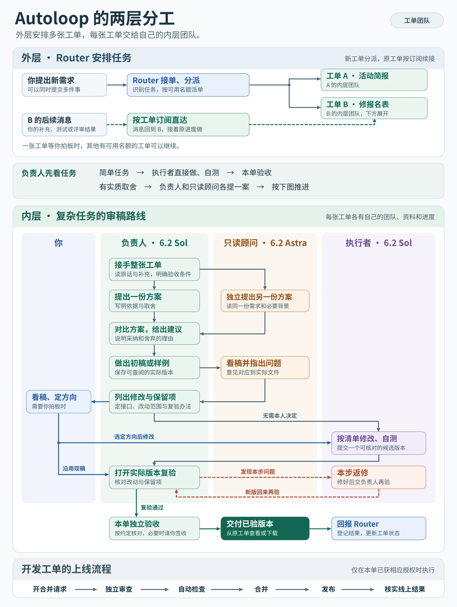

# 一张工单，一个团队

你可以同时交代“写活动简报”和“修报名表”。打开报名表原单补一句“联系人改成林老师”，这条消息回到报名表团队。简报等你选风格期间，报名表仍可推进。

## 工作台上的操作

1. 从首页「新建工单」写目标与完成标准。Router 在本机登记原话、工单和订阅，把这张工单分给自己的团队。勾选发送许可后，团队才能使用本次填写的文字。
2. 团队整理目标和验收条件。批准本版后开始制作。负责人在本单规划里确定哪些步骤可以直接做。机械修改由执行者直接制作、自测。只有存在影响结果的取舍，或你明确要求比较时，负责人才与只读顾问各出一案，再做初稿、审稿和列修改项。原单会在需要你定方向时展示选项。
3. 原单「补充资料」交给本单团队。涉及更换目标或验收标准时，选择「修改要求」，看过新版后再批准。普通补充不会增加授权。可以从原单核对发送记录、资料是否交给角色以及候选版本的回执。
4. 执行者修改并自测，负责人打开候选复验。有问题就返修，复验通过再按已批准标准独立核验。涉及内容质量等需本人判断的条款，在原单签收或退回。签收绑定具体版本，封存后收到的材料单独显示。
5. Router 登记进度和最终回执。等待你决定的工单释放执行名额。已授权的其他工单可以使用空位。查看已有工单时保留原版本、授权与归档。

开发工单的上线授权还需覆盖目标仓库和发布范围。在对应交付流程核对合并请求、独立审查、自动检查、合并、发布和线上验证。原单签收文件与线上版本核实分别留证。

## 角色与替换

新工单的负责人、执行者与独立复验角色用 GPT‑6.2 Sol，只读顾问用 GPT‑6.2 Astra。规划和实施通常用中等思考强度，顾问、复杂方案比较和独立复验用高强度。进入原单可查看本次实际调用的模型、角色和路线。

模型与执行器由本机安装版本登记。要换模型或 coding agent，新建一版角色配置，给新执行器实现同一份调用契约，分别核验模型身份、只读与可写工作区、截止时间及回执。新单使用新版本，在途工单按其已批准的版本恢复。[角色配置与适配器](../../网页工作台/superagent/team_profiles.py)

## 验收方式

用两张无私人资料的合成工单，从工作台登记并核对各自的团队。第一张只需按后缀筛选已给定的文件名，检查实际调用中只有 Sol 执行者直接制作。第二张有影响成品的取舍，检查负责人和只读 Astra 分别给出独立方案。让一张等待决定，给另一张追加一条可核对的资料。检查第一张没有这条消息，第二张的执行回执与候选均能追到本次输入。改变验收要求时须回原单重新核对版本。用已封稿版本验证迟到消息，再核实旧归档的下载内容。

[派工调度](../../网页工作台/superagent/ticket_dispatcher.py) · [工单绑定与订阅](../../网页工作台/superagent/outer_intake.py) · [内层审稿与复验](../../网页工作台/superagent/goal_team_run.py) · [归档与独立验收](../../网页工作台/superagent/outer_verification.py)

[开发工单的发布授权与回单](../operations/ticket-development-delivery.md)
