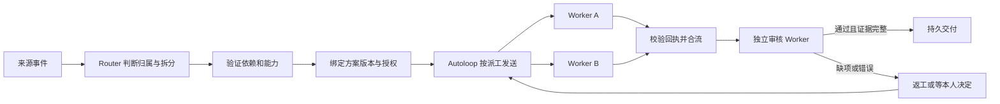

# Autoloop 执行端 Superagent 改造方案

2026-11-18。交付目标是一张工单能跨会话、跨 Worker 执行，在授权范围内自主管理依赖、失败和返工，最终用可复核的证据交付。飞书和看板读取同一工单及证据。授权动作沿用本人决定的边界。

## 现状与迁移选择

现用 Autoloop 已有来源事件去重、规则路由、按事项排队、Worker 领取、心跳、取消、审批卡与审计流。工作台另外维护任务和版本。现有单条 `odyssey-workbench` 规则把工单交给一个 Runner，Runner 持整单租约，按规划、实施、审核逐次调用模型。它能跨会话保留任务，缺少同一工单的多个独立派工、依赖合流和按能力路由。先在现有 Autoloop 上增加协调器和专用规则，复用上述底层协议，逐步把复杂工单切到新流程。[现有 Runner](task_runner.py) · [现有工作台](workbench.py)

## Codex 原生编排与 Autoloop 工单编排

Codex 支持用独立工作树并行运行多个会话，也支持在一个会话内派出专职子 Agent 并汇总。普通代码改动、一次性调研及单次交付优先利用这些能力。Autoloop 的增量价值是管理跨入口、跨授权、跨会话的工单生命周期，以及多张受管工单对同一资源的竞争。[Codex 工作树](https://learn.chatgpt.com/docs/environments/git-worktrees) · [Codex 子 Agent](https://learn.chatgpt.com/docs/agent-configuration/subagents)

| 任务情形 | Router 采用的路径 |
| --- | --- |
| 临时任务，目标明确，一次 Codex 会话可交付 | 直接使用 Codex。若任务从飞书或看板进入，Autoloop 维护同一工单的进度与交付，实际执行交给一个 Codex 会话 |
| 单张工单有独立读、查、测分支，同一授权即可覆盖 | 由该 Codex 会话调用原生子 Agent，按需要合并结果；需要核验时读取执行会话提交的证据 |
| 工作包需要独立授权、不同执行器、独立重跑或显式验收 | 把这些边界设为 Autoloop 派工节点。每个节点仍可利用执行器原生能力 |
| 持续触发、跨天、等待用户、跨设备或跨项目协调 | Autoloop 持久化工单和授权，依据回执恢复，按优先级和资源锁协调执行 |

拆单依据是依赖、授权、可独立验收和共享资源。工单总数用于衡量积压与等待，不决定每单需要几个 Agent。并发上限主要约束 Autoloop 直接管理的执行轮次、共享工作区写入与账户消耗。允许某轮使用 Codex 原生子 Agent 时，为该轮单独约定子 Agent 的预算或并发配置；缺少可强制的计量时，采用保守的名额预留，关键受控分支由 Autoloop 显式派工。手动启动的 Codex 会话占用同一账户资源，但不在 Autoloop 的直接控制范围内。

早期的 24% 用时差来自同一个 Autoloop 试点的串行和并行对照。比较系统是否值得使用时，增加 Codex 原生并行作为基线。短任务比较总耗时、用量和交付质量。另用跨设备批准、执行中重启、单分支重跑和不同工单共享资源的案例，比较需要本人协调几次、是否正确恢复、是否重复执行及最终证据。

## 把 Super-agent 的领域边界落实到执行端

| 概念 | 本项目职责 |
| --- | --- |
| Source / Trigger / Thread | 用现有飞书、看板或内部来源接收事件。按来源和事件 ID 去重。已绑定的回复沿原工单；无明确归属的内容由 Router 评估或交本人选择 |
| Eval / Router | 先判断忽略、补充、澄清或建立工单。复杂任务由 Router 产出有依赖的工作包，标明能力、输入范围、输出、验收和并行依据。可信代码验证方案并派工 |
| Policy / Mandate | 规则描述可授权范围。每次授权保存工单与版本、方案摘要、资源范围、工具动作、时限和批准来源。改版或扩大权限另起版本 |
| Ticket / Subscription | 工单跨进程和会话持久化。订阅只提供资料或通知，资料进工单后按版本读取 |
| Assignment / Executor | 每个工作包产生独立派工尝试，有明确能力、期限、执行空间和结果。Autoloop Run 负责运输、调度和进程生命周期。业务端核对该结果对应的派工和工单版本 |

领域模型借自 DeepSeek 原型。原型入口的 Router 负责评估事件与派工，本项目在同一工单内增加有向依赖图，借用相同的工单、授权与派工边界。并行下发是工作台对复杂任务的扩展。[DeepSeek 领域模型](https://github.com/deepseek-ai/dsh-superagent-prototype/blob/main/docs/001-domain.md)

## 执行链

### Router 如何拆分和派工

1. 从工单目标和验收条件提取交付物、约束、必需工具和未决信息。对会改变结果的歧义先发澄清。普通工单保留一个工作包，复杂工单才增加并行包。
2. 工作包写成可验证契约。每包有稳定 ID、能力、依赖、输入引用、写入范围、验收条件、时限。程序检查环依赖、未知能力、读写重叠、无法覆盖的终验条件和预算。相互独立且拥有独立输出目录的工作包才可并行。
3. 由可信能力表选 Worker。能力是「处理结构化数据、审阅、实现」及对应权限。模型名是该能力路由的一项配置。首版用 Codex 6.2 Sol 执行和审核。只有复杂的架构方案设计可选择 6.2 Astra，调用理由、模型和耗时进入记录。
4. 先事务写入派工与待投递记录，再发 Autoloop 事件。以派工尝试 ID 作为事件去重键，也作为 `subject`。Autoloop 的 `parallel` 按事件事项分道，同一个工单 ID 若直接当事项会被串化，还可能在重试时并入同事项新事件。独立的派工尝试保证两条工作包真正独立。传统工单仍用原事项键。
5. Worker 从自己的派工信息读取最小上下文，核对冻结版本、授权摘要和能力。只取任务允许的合成或本地输入；结果与检查证据写各自尝试目录。在回执中仅带派工指针和最小摘要。

### 多工单调度与 Worker 容量

试点用两个工作包证明同一张工单可以并行，再用第三个 Worker 验收。三个 Worker 都只开一个执行名额，试点账本每个目录只存一张工单。生产设计需要同时管理多张工单，每种能力可注册多个 Worker，每个 Worker 可配置多个执行名额。提交新工单无需先有空闲 Worker。

1. **持久排队。** 每张工单有独立的 `ticket_id`。派工主键至少包含工单 ID、方案版本、工作包 ID 与尝试号。两张工单即使提交了相同输入、生成了相同方案，也要分别授权和执行。Autoloop 的事件去重键和事项键使用具体派工标识，路由与恢复按工单 ID 查关联。
2. **按能力领取。** Router 为已通过依赖和授权检查的工作包选匹配的能力路线。上线初期可把能力映射到预设 Autoloop 规则和 Agent，由配置决定执行它们的 Worker。某个能力缺容量时，该包继续等待，其他能力的就绪工作照常推进。扩容时可以给现有 Worker 增加名额，也可以新增能承担同一能力的执行路线与 Worker。
3. **分配名额。** 并发受 Worker 可用名额、Autoloop 规则组与 Agent 上限、账户额度、工单预算和共享资源写入权共同约束。默认同优先级先让每张可运行的工单获得一个机会，再把余量分给可并行的工作包。已经释放执行轮次的待审批工单只留待办。写同一个项目或资源的工作包按资源锁顺序进入。执行情况未知时保留租约，查清原轮状态后再补派。
4. **展示真实等待原因。** 工单区分待依赖、等待匹配的 Worker、等待审批、执行中和待核对。账户限流按服务端允许的时机再派工。同一工单的审核只在所需分支通过后派出，审核能力的容量单独计数。

例如提交五张工单，每单当前各有一个可运行且互不冲突的工作包。若合计只有四个匹配的空闲名额，前四张各推进一个工作包，第五张持久排队，任一匹配名额释放后领取。若第五张需要不同能力，而该能力此时空闲，它可以直接推进。后续扩容验收要用真实 Autoloop 提交五张工单，在四个可用名额下观察峰值不超四、五单都完成，并重复验证同方案不同工单、一个大工单与多个小工单共存，以及 Worker 下线或重启后的余量与回执。现有实测覆盖单工单，五工单容量测试待执行。

### 动态并发上限

现役工作台规则的上限为 1，本机 Worker 总容量为 2。生产试点建议先验证 **1 至 2 个动态执行名额**。在 2 个名额下完成多工单峰值、审核积压和中断恢复验收后，再逐级验证 3 和 4；**4 是候选硬上限**，取决于实际机器、其他 Autoloop 业务和 Codex 账户的实测表现。并发值用配置维护。上线时先探测各层实际生效的限制。

- **按可立即执行的工作包调整。** 空闲时无需运行模型。先派一包，当满足授权、依赖、能力和资源锁的工作仍在排队，且对应 Worker 和账户有余量时，逐次增加一个执行名额。一个工单有两条独立支路也可以触发扩容。待审批、待资料、待依赖和已开始的包不计入就绪积压。
- **固定资源上限，动态放行。** Router 在已部署的 Autoloop 容量内改变同一时刻放行的派工数。实际可放行数量取配置硬上限、匹配 Worker 的可用名额、Autoloop 规则及 Agent 限制，以及账户限制中最紧的一项。无需为每一次积压启动新进程。独立审核同样占一个执行名额；审核已就绪时，优先使用下一个匹配的空位。
- **降速和稳定性。** 积压消退后随任务结束自然回落。若观察到 Codex 限流，先按可用的重试时间冻结该提供方的新派工并下调可用名额，恢复后逐级放开。Worker 掉线后只用已知在线容量；存在执行状态未知的写入轮次时保留对应资源锁。在途任务按原授权继续。模型并发上限约束同时运行数，累计调用和时间预算另行约束单张工单。
- **用指标决定是否加一档。** 用同一组合成工单分别在 1、2、3、4 档记录排队用时、完成用时、限流、并发峰值、重试、审核等待及错误率。先验收 1、2 档。下一档应在多次可比运行里减少排队，并且限流、审核积压和其他业务受影响的情况可接受，才进入日常配置。把待审批工单混入用例，验证它们不会被误统计为扩容需求。

当前工作完成了弹性规则设计。现役配置和负载验收分别记录，生产硬上限以负载证据确定。

### 授权与审核

- 用户的同意绑定最终可读方案和 Mandate 摘要。工作包只继承授权的子集。模型不能新增权限、调用本人接口、选择凭据、在授权外读写、对外发送或批准自己。Worker 进程使用单轮 token，授权和协调密钥只在协调器侧。
- 并行段分别校验结果格式、工单版本、派工身份和代次。依赖回执全部有效后，协调器生成不可变审核输入。审核使用独立会话及原始合成输入，对分组、总量、排除项和边界逐条复算。审核的通过意见和确定性检查必须同时成立。
- 审核失败后先把意见定位到责任工作包。未超授权且旧尝试已终止，可仅重做受影响包，并使其下游结果失效。新范围、超预算或外部动作回本人决定。最终状态只能由协调器依据审查与验收证据写入。

### 失败与恢复

| 故障 | 处理 |
| --- | --- |
| 发送回执丢失 | 重发同一个来源事件 ID，随后按 Autoloop 事件查实际 Run。避免新号重发 |
| 协调器重启 | 从持久计划、授权、派工和业务回执恢复。逐项核对 Autoloop，再运行满足依赖的下一步 |
| Worker 退出或心跳未知 | 保留当前尝试，查询 Run 和已保存的回执。未确认停止时不重新发同一写入任务 |
| 旧尝试迟到 | 依据任务版本、派工尝试及生效代次核对。旧记录可追查，当前成果保持对应版本 |
| 部分成果失败 | 保留其他已验收产物。可重试的那包在旧轮确认为终态后开新尝试，独立审核复跑 |
| 执行完成但业务校验失败 | 运输层可以正常回执。工单标记需复核或失败，发布成果的门保持关闭 |

## 分段交付

| 里程碑 | 放行证据 |
| --- | --- |
| 隔离首条全 Codex 复杂工单 | 两个能力 Worker 同时处理独立分支，独立审核在合流后开始。每个工作包有不同真实 Codex 会话、Autoloop Run、调用起止、模型路由和校验结果。仅用合成资料 |
| 执行端试点及恢复 | 执行真实 hub 重启、未知与晚到、重放、错误审核、预算耗尽和部分失败。单工单的结果可从数据库与 Run 追责。试点用命名来源、独立规则和已有版本授权入口 |
| 旧工作台接入 | 原工单仍走旧 Runner，新工单按显式试点路由走新协调器。迁移先双读，再逐类放行。通过双端同单、旧卡、暂停、预算、进度及交付回归。回退可停止新接单并保留未决记录 |
| 模型与工作范围扩展 | 在相同契约上验证其他能力适配器。跨机器、代码合并和真实资料各自验证最小权限。用重复的单 Worker 串行基线与并行执行对比质量、总耗时和用量 |

首个样例是跨两个日期口径的质量核账。并行包一汇总发生日期，包二去重、核对有效数和排除项。审核用原始合成行和两个结果独立复算。认定效率时记录串行基线是否实跑。并行段的重叠用于证明调度，单次重叠无法估计通用加速。

## 后续开发指令

> 在已经核对的 Autoloop 实例上实施本方案。把事件评估、工单授权、依赖派工、回执合流和独立验收做成可恢复的运行路径。先运行隔离合成样例。架构难题用 6.2 Astra 子 Agent，其余实现、测试和独立审核用 6.2 Sol。开工后由 Router 分派无冲突的工作包；工作区有多个产物时每个路径只交给一个写入者。给每包明确输入输出、Mandate、期限及验收。先取真实 Run、调用会话、时间和回执，再下结论。执行失败时从已验收工作的检查点恢复。旧工单和业务路由更新按本机既有授权范围选择试点。

实施入口位于 `superagent/`，首个隔离试点的运行方法、样例与结果从该目录 README 进入。
